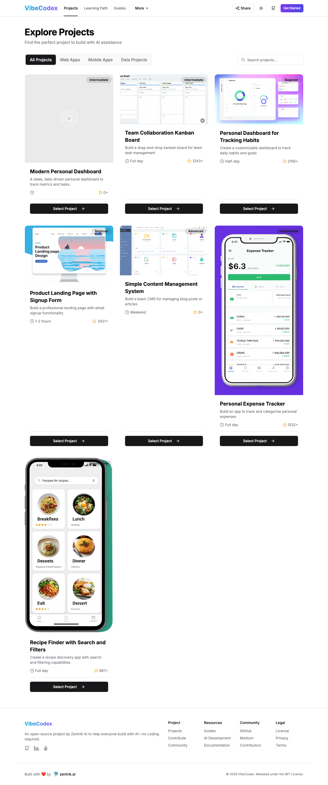
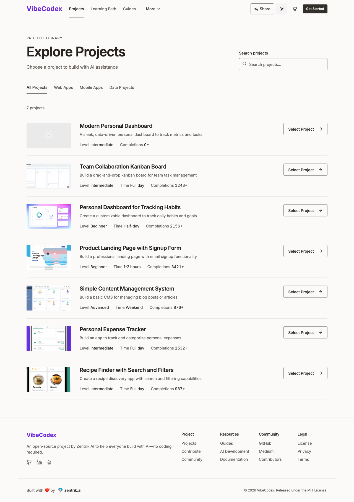

# A project catalog should help you compare projects

Draft for Flavius to edit before posting. This is a public, MIT-licensed application, not client work. Taste ratings are agent self-review and have not been approved by Flavius.

VibeCodex is a learning app built with v0.dev and Cursor according to its pinned README. The project catalog already had search, category controls, real destinations and an empty-state reset. I kept those behaviors and changed four screens in a scratch clone. No issue or PR was opened upstream.

The first problem was comparison. Desktop cards mixed small landscape screenshots with very tall phone mockups. A phone made its whole row taller, leaving effort and actions far apart. The redesign keeps media as bounded previews and puts titles, difficulty, time and completion counts in consistent rows. Nothing about the task required removing the previews.

A search field also needs a name after you start typing. I added a persistent visible label and gave essential input boundaries their own token. The measured boundary contrast is 4.07:1 in light mode and 5.47:1 in dark mode. Decorative separators stay quieter. The same distinction carries through the theme.

Other fixes were less visible but mattered more than changing the palette. Existing radio choices had no associated accessible names. A wrapper declared asChild but never passed it through, producing nested links and buttons. Those fixes retain the controls' existing values and destinations. Focus uses a visible 2px outline. The reduced-motion check found no running decorative animation after the changes.

The guide catalog, goal selection and learning-path page now put their task before the marketing hero. Section headings, rows and measured spacing carry the hierarchy. VibeCodex retains its name and violet identity. Editorial calm is a working variant here, not a requirement to import somebody else's whole brand.

## What the evidence supports

The build passed before and after. Fourteen exercised behavior triggers pass after the redesign, with additional checks for mobile sheet focus and milestone expansion. Source data hashes match; project completion values and destinations are unchanged. Screens were recaptured at 375 and 1280 in actual light/dark states, with long content, empty search, open navigation and expanded content.

The first enlarged-text geometry check missed overlapping lines. Visual review found them, and the correction was checked again at 320, 375 and 1280 with all rendered text enlarged to 200%. That rescue is part of the report. A screenshot without overflow is insufficient evidence by itself.

The original completion counter animates only when it enters the viewport. Untouched full-page baseline captures include unfinished values below the viewport. A separate scrolled-and-settled baseline makes the comparison fair; the original captures remain available.

## What stayed outside the sprint

The category filter uses a project ID test rather than the data's category. Some choices return no projects. That is existing product behavior and remains documented rather than silently changed in a visual sprint.

The upstream build suppresses type errors. Running TypeScript separately fails before and after with byte-identical output. A passing build is therefore not a clean typecheck. No authentication or server mutation exists in the selected flow, and no screen reader or physical-device test was performed. Those limits remain visible beside the rubric instead of disappearing into a taste score.

The [full run](../eval/golden/vibecodex/README.md) contains the patch, pinned source/license, contract, captures, measured checks and rescue log. The [audit-only run](../eval/golden/vibecodex-audit/README.md) took 370 seconds and stops at one project-catalog prototype. It is a scoped audit example, not a claim about every app's delivery time.

Before publishing, edit this draft into Flavius's own voice, inspect the images and decide whether the proposed hierarchy fits his taste. The mechanical evidence is recorded; authorship and judgment still need his review.
