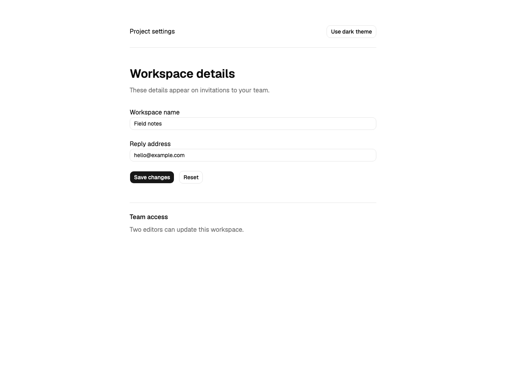
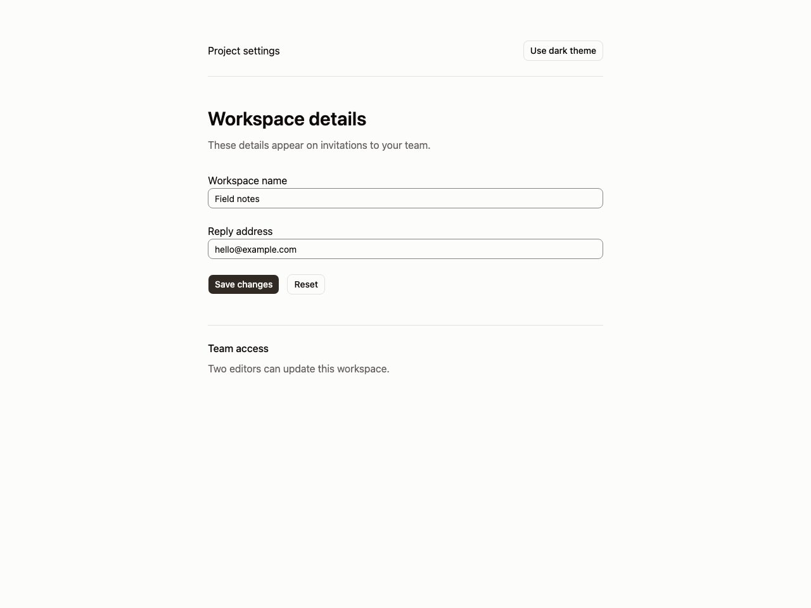
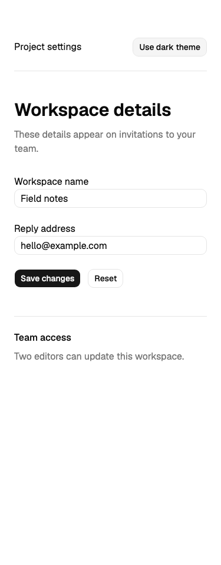
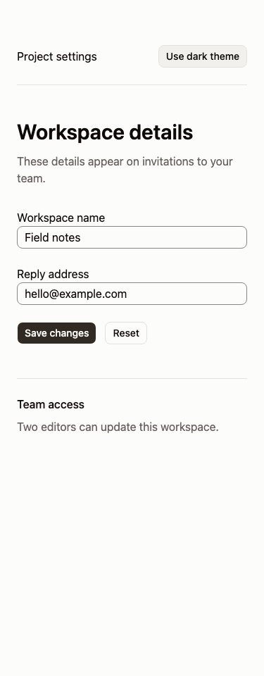

# Registry install verification

A fresh scratch Next.js app was initialized with shadcn 4.21.4 using `npx shadcn@latest init --defaults --yes`. The default preset installed its button. `npx shadcn@latest add input --yes` added the input. The same settings form was captured before and after installing the locally served registry item:

```sh
python3 -m http.server 4320 --bind 127.0.0.1
# In the scratch app:
npx shadcn@latest add http://127.0.0.1:4320/registry/r/editorial-calm.json --yes
npm run build
```

The CLI validated the item and changed app/globals.css. The build passed. Both manifests record Chromium 149, actual light/dark backgrounds and no page errors or horizontal overflow at 375/1280px. All four before/after background pairs differ. The after form has graphite actions, warm neutral paper and visible input outlines. A theme changes roles and radius; composition remains the consuming app's responsibility.






The [fixture](fixture/app/page.tsx) preserves the form used for both captures. The post-install CSS, components configuration and exact dependency lock are retained alongside it. The form's alert explicitly describes a local install test, not a real workspace mutation.

The first init attempt failed because the minimal starter lacked next.config.ts. Adding that conventional file fixed framework detection. The portable starter now includes it. No manual components configuration substituted for the requested fresh CLI initialization.
