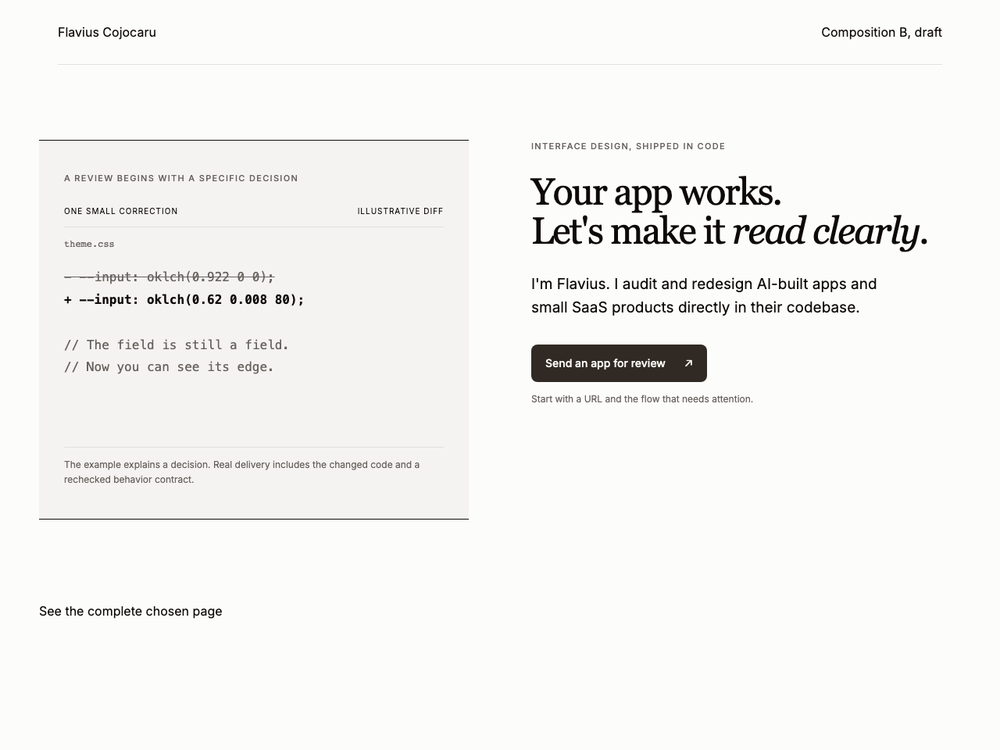

# Service landing page

A complete one-page Next.js service site was built with new-site mode. The [brief](brief.md) records audience, action, content, two composition choices and the reason for selecting A. The [source](source/app/page.tsx) uses the optional starter and adds no dependency. Draft terms and illustrative material are labelled; no client evidence, logos or testimonials are invented.




To reproduce outside this repository:

```sh
cp -R eval/golden/service-site/source /tmp/flavius-service-site
cd /tmp/flavius-service-site
npm install
npm run build
npm run start -- --port 4315
```

The full page is `/`; hero alternatives are `/options/a` and `/options/b`. The build and TypeScript pass. Twelve captures cover all routes at 375/1280 in system light/dark. [Verification](verification.json) records the full page's measured text/action contrast, focus outline, section navigation, native FAQ expansion, real contact destination and 200% text composition in four cases.

The contact opens an email draft to the public portfolio address. It sends nothing and reports no false success. Typography uses locally bundled Inter under its [font license](source/public/fonts/OFL.txt), Georgia display and system monospace. The two original directions remain independent.

Observed rescue: the root-relative public font URL worked in Next.js but the repository's filesystem link checker interpreted it against this repo root. Importing the same asset by a relative CSS URL let Next.js bundle it and made the retained source independently checkable. The diff illustration was changed to syntactically valid CSS custom-property lines before final capture. No skill rule was added for those local corrections.

Unverified: screen-reader output, email-client configuration, external analytics and live hosting. These are outside this one-page implementation. Final service copy and terms remain for the owner's editorial review before a public service deployment.
