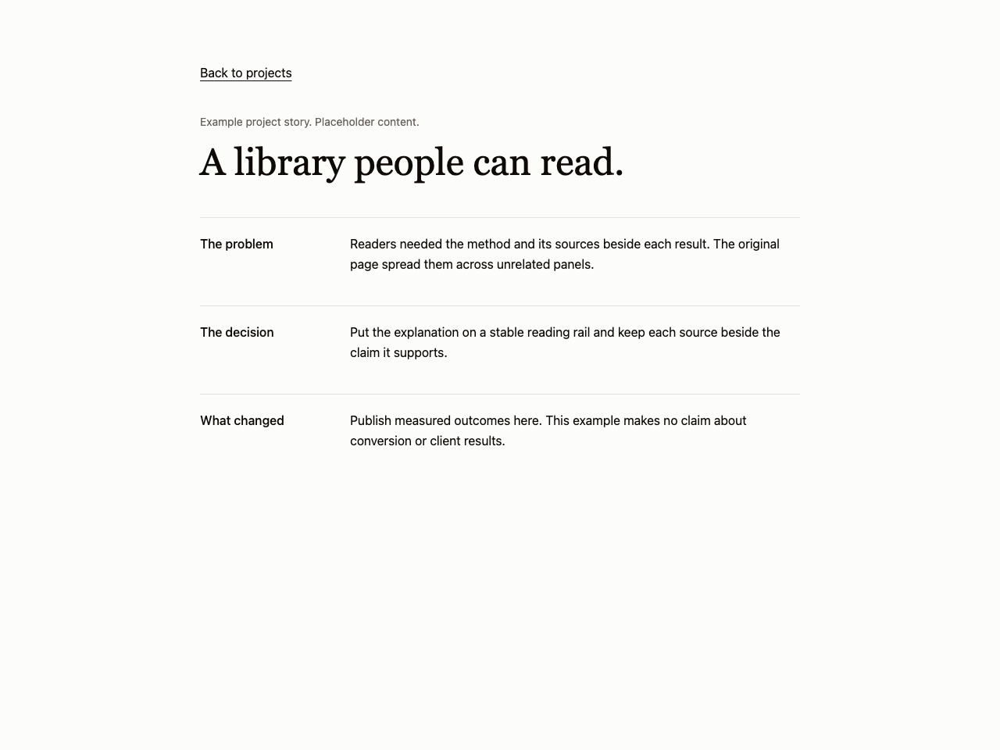
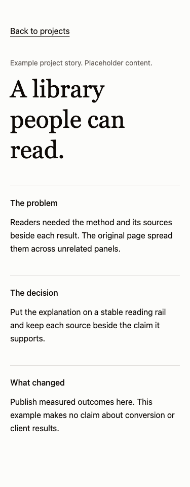

# Project case study

Use for a project story with a problem, decision and evidence. Avoid for invented success claims or stories without permission to publish.

Provenance: the portfolio CaseStudy.tsx and TheShelf.tsx project write-ups. See the [existing work](../../references/own-work/portofolio.md) for evidence and source context. This is a portable adaptation, not a claim that the new snippet shipped in that project.

This page adaptation keeps the story sequence and a real return anchor. It does not copy the shelf metaphor or the portfolio dialog flow.

Use [the component](example.tsx) with React and Tailwind v4 semantic roles from your theme. Native controls can be replaced by equivalent existing shadcn controls while preserving labels, focus and callbacks.

