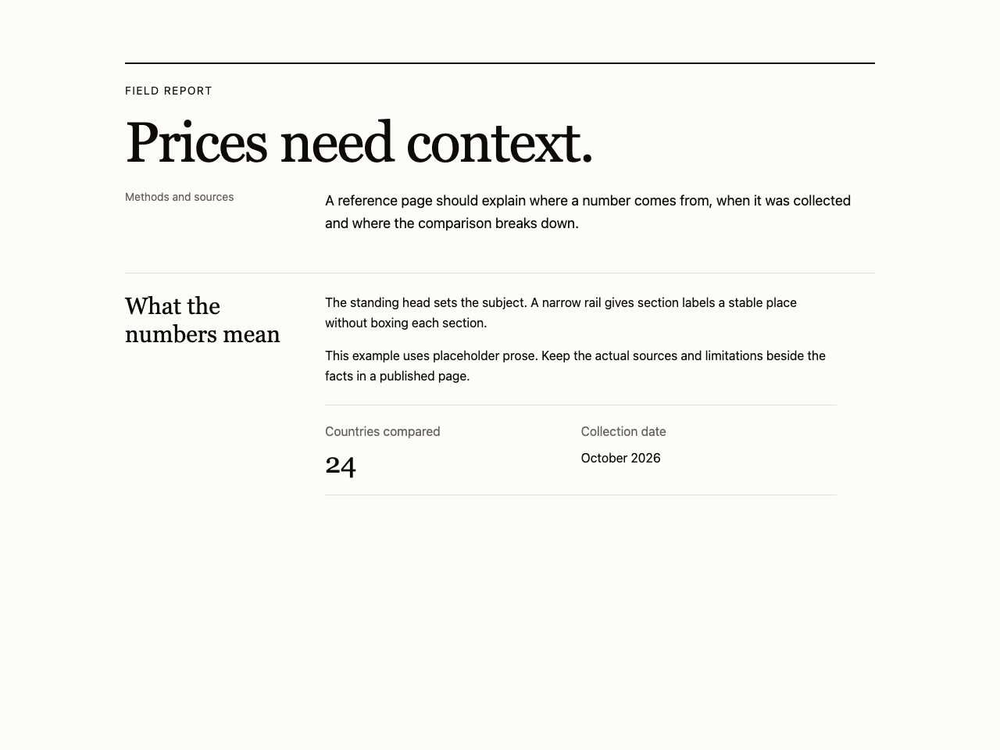
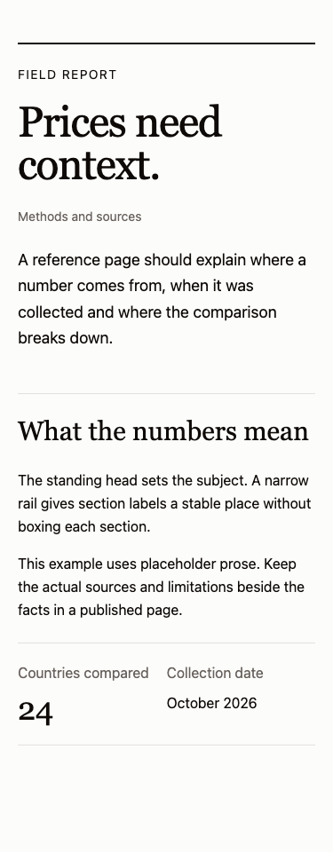

# Standing heads and grid rails

Use for reference pages and landing pages with a substantial explanation. Avoid for dense operator tools or headlines with no supporting content.

Provenance: Pricele ContentPage.tsx and its rendered methodology page. See the [existing work](../../references/own-work/pricele.md) for evidence and source context. This is a portable adaptation, not a claim that the new snippet shipped in that project.

At narrow widths the 13rem rail becomes a heading above the prose. Hairlines mark the reading order. Instrument Serif, Archivo and IBM Plex Mono are optional role choices from Pricele, not a third direction.

Use [the component](example.tsx) with React and Tailwind v4 semantic roles from your theme. Native controls can be replaced by equivalent existing shadcn controls while preserving labels, focus and callbacks.

