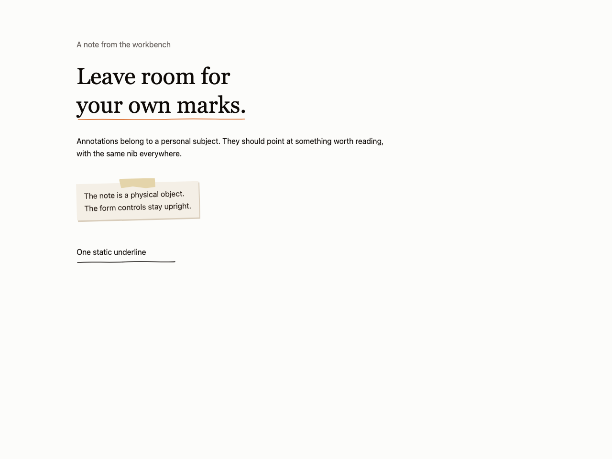
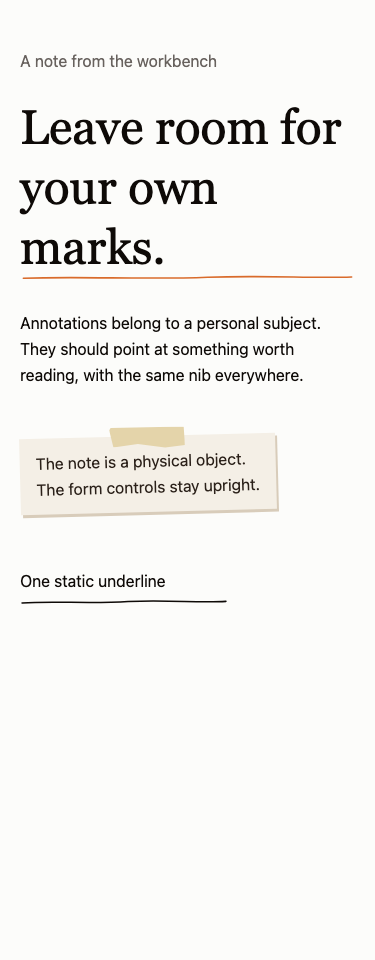

# Ink marks and taped notes

Use for a personal subject with a reason for annotation or physical paper. Avoid for ordinary settings forms, legal copy, or annotation as the only status signal.

Provenance: portfolio ink/Underline.tsx, ink/Scribble.tsx and art/Paper.tsx. See the [existing work](../../references/own-work/portofolio.md) for evidence and source context. This is a portable adaptation, not a claim that the new snippet shipped in that project.

Underline paths and tape geometry come from the pinned portfolio code. Scribble is a static underline adaptation of its rough-notation wrapper, avoiding a new runtime dependency. Circle, box and multiline rough annotations are outside this small extract. Marks are hidden from assistive technology; children stay readable. Motion is opt-in and reduced motion draws the complete mark immediately.

Use [the component](Ink.tsx) with React and Tailwind v4 semantic roles from your theme. Native controls can be replaced by equivalent existing shadcn controls while preserving labels, focus and callbacks. Ink also needs [its small stylesheet](ink.css).

