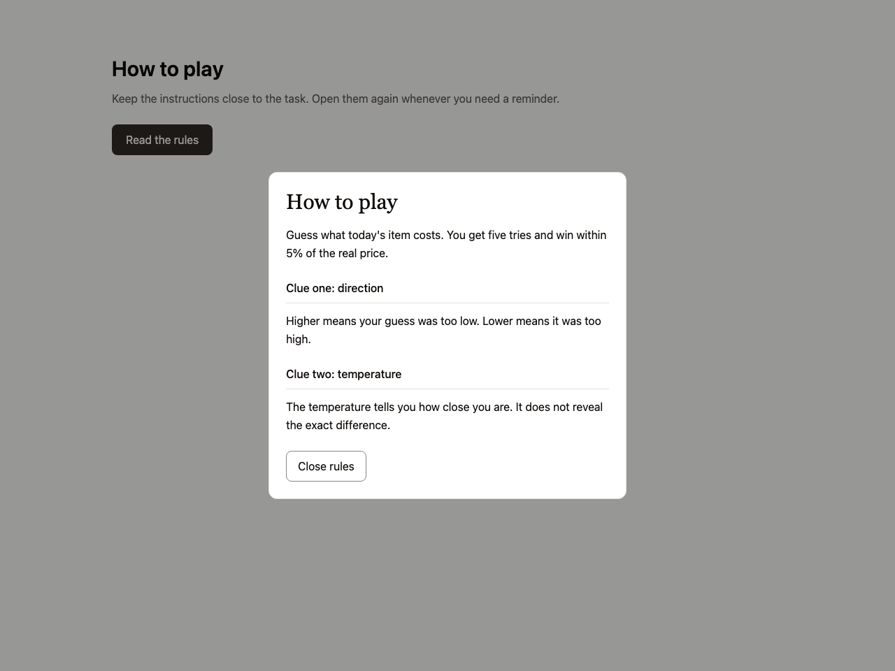
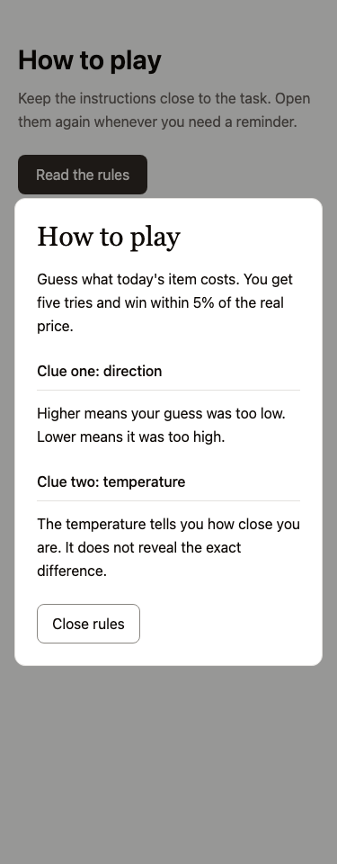

# Instructions beside the task

Use for short instructions that users need to reopen during a task. Avoid for multi-step identity verification or a navigation redesign.

Provenance: Pricele HowToPlay.tsx at the pinned own-work commit. See the [existing work](../../references/own-work/pricele.md) for evidence and source context. This is a portable adaptation, not a claim that the new snippet shipped in that project.

The instructions are adapted from the game, using a native modal dialog. Substitute the existing shadcn Dialog in an app that already owns overlay behavior. Do not nest dialog systems.

Use [the component](example.tsx) with React and Tailwind v4 semantic roles from your theme. Native controls can be replaced by equivalent existing shadcn controls while preserving labels, focus and callbacks.

