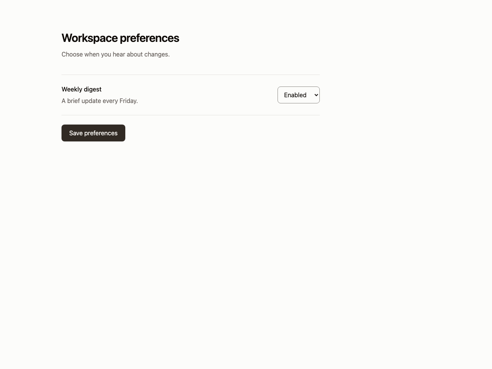
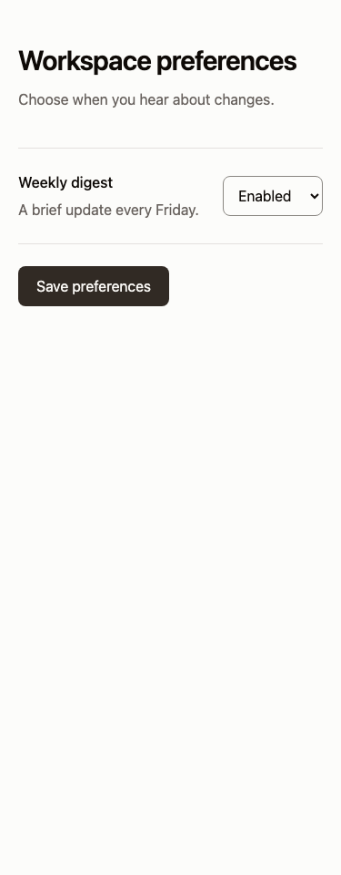

# Settings rows

Use for preferences, where the control belongs beside its explanation. Avoid for unrelated controls or actions that have different permission boundaries.

Provenance: the original Editorial calm preferences row and settings specimen. See the [existing work](https://github.com/flvvius/flavius-design-taste/blob/v1-before-restructure/examples/index.html) for evidence and source context. This is a portable adaptation, not a claim that the new snippet shipped in that project.

The React form adds a truthful local save demonstration. Replace its callback with the existing application mutation and validation.

Use [the component](example.tsx) with React and Tailwind v4 semantic roles from your theme. Native controls can be replaced by equivalent existing shadcn controls while preserving labels, focus and callbacks.

