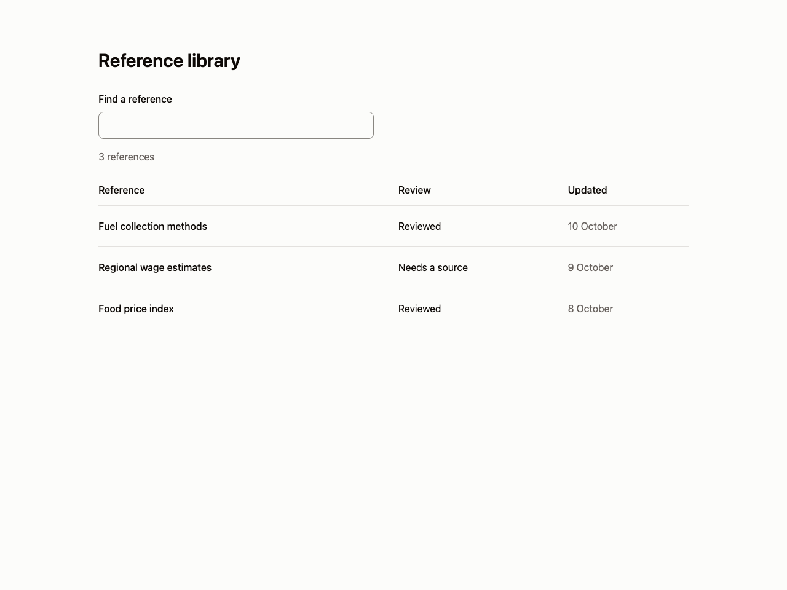
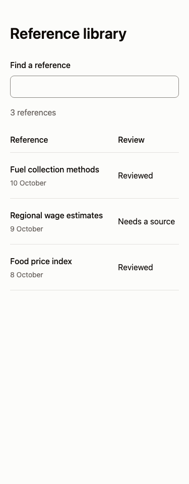

# Table and filters

Use for small bundled collections whose metadata can be compared. Avoid for remote pagination or requests without cancellation and query provenance.

Provenance: the archived searchable article collection and responsive table work. See the [existing work](https://github.com/flvvius/flavius-design-taste/blob/v1-before-restructure/eval/cycles/27/index.html) for evidence and source context. This is a portable adaptation, not a claim that the new snippet shipped in that project.

This synchronous example avoids async races. It retains the query, result count, row boundaries and mobile metadata. Wire remote states into the existing contract.

Use [the component](example.tsx) with React and Tailwind v4 semantic roles from your theme. Native controls can be replaced by equivalent existing shadcn controls while preserving labels, focus and callbacks.

